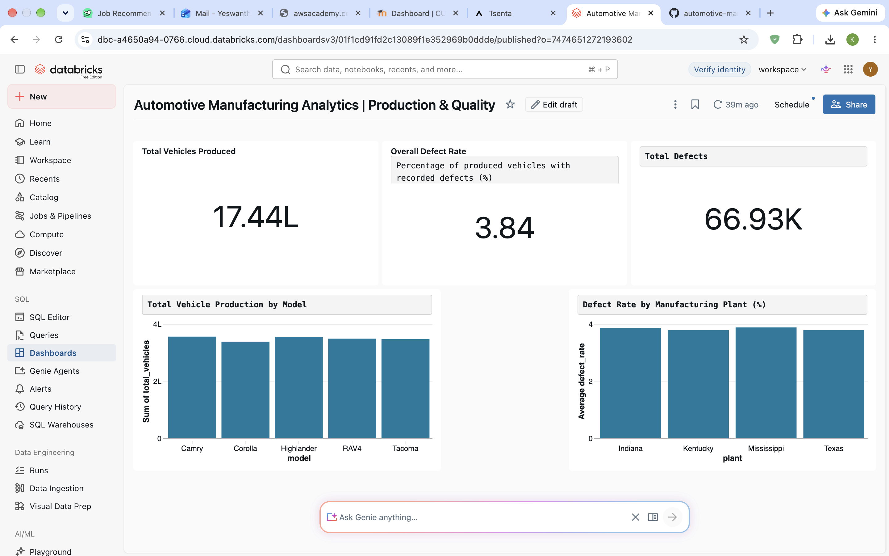

Automotive Manufacturing Data Engineering Pipeline

End-to-End Data Engineering Project | Databricks | PySpark | Delta Lake | Spark SQL

📌 Project Overview

This project demonstrates an end-to-end data engineering pipeline for analyzing automotive manufacturing production and quality data.

The solution uses Databricks, PySpark, Delta Lake, and Medallion Architecture to transform raw manufacturing records into structured datasets and actionable business insights.

The project uses 10,000 synthetically generated production records representing four manufacturing plants and five vehicle models.

Note: This is an independent portfolio project using synthetic data. It is not affiliated with Toyota or any automotive manufacturer.

🏗️ Data Architecture

The pipeline follows the Medallion Architecture:

Synthetic Data Generation → Source Delta Table → Bronze → Silver → Gold → Spark SQL → Databricks Dashboard

Bronze Layer — Raw Data Ingestion

* Reads manufacturing data from the source Delta table.
* Preserves raw production records.
* Stores ingested data in a Bronze Delta table.

Silver Layer — Data Cleaning

* Removes duplicate production records.
* Validates manufacturing data.
* Prepares cleaned records for analytics.
* Stores processed data in a Silver Delta table.

Gold Layer — Business Analytics

Creates aggregated datasets for:

* Overall manufacturing KPIs.
* Production performance by vehicle model.
* Manufacturing quality by plant.

🛠️ Technologies Used

* Databricks: Cloud-based data engineering and analytics.
* PySpark: Distributed data processing.
* Delta Lake: Reliable data storage using Delta tables.
* Spark SQL: Business analytics and data querying.
* Python: Synthetic data generation.
* GitHub: Source code version control and project documentation.

📂 Project Structure

automotive-manufacturing-data-engineering/
│
├── 00_Generate_Manufacturing_Data.py
├── 01_Bronze_Data_Ingestion.py
├── 02_Silver_Data_Cleaning..py
├── 03_Gold_Manufacturing_Analytics.py
├── 04_Spark_SQL_Analytics.py
├── README.md
└── .gitignore

📊 Manufacturing Analytics Dashboard

An interactive Databricks dashboard visualizes manufacturing production and quality performance.

Key Performance Indicators

KPI	Result
Total Vehicles Produced	Approximately 1.74 million
Total Defects	Approximately 66,930
Overall Defect Rate	3.84%
Manufacturing Plants	4
Vehicle Models	5

Dashboard Visualizations

1. Total Vehicles Produced

Displays the total number of vehicles manufactured.

2. Overall Defect Rate

Shows the percentage of produced vehicles with recorded defects.

3. Total Defects

Displays the total number of manufacturing defects.

4. Vehicle Production by Model

Compares production volumes across Camry, Corolla, Highlander, RAV4, and Tacoma.

5. Defect Rate by Manufacturing Plant

Compares manufacturing quality across Kentucky, Texas, Indiana, and Mississippi.

📁 Dataset Description

The synthetic manufacturing dataset contains the following columns:

Column	Description
production_id	Unique production record identifier
production_date	Manufacturing production date
plant	Manufacturing plant location
model	Vehicle model
units_produced	Number of vehicles produced
defect_count	Number of recorded defects

🚀 How to Run the Project

1. Create a Databricks workspace with access to PySpark and Delta Lake.
2. Import the Python notebooks into Databricks.
3. Execute 00_Generate_Manufacturing_Data.py to generate the synthetic source data.
4. Execute 01_Bronze_Data_Ingestion.py to create the Bronze layer.
5. Execute 02_Silver_Data_Cleaning..py to clean and validate the data.
6. Execute 03_Gold_Manufacturing_Analytics.py to generate business aggregates.
7. Execute 04_Spark_SQL_Analytics.py to analyze the Gold datasets.
8. Create dashboard visualizations using the Gold tables.

Run the notebooks in the order listed above.

🎯 Project Outcomes

This project demonstrates practical experience with:

* Building end-to-end data engineering pipelines.
* Implementing Bronze, Silver, and Gold data layers.
* Processing manufacturing data using PySpark.
* Creating and querying Delta Lake tables.
* Writing analytical queries using Spark SQL.
* Building business KPI dashboards in Databricks.
* Organizing and documenting a data engineering project using GitHub.

📌 Future Enhancements

* Automate pipeline execution using Databricks Jobs.
* Implement incremental data processing.
* Add data quality checks and automated tests.
* Introduce realistic manufacturing data anomalies.
* Add production monitoring and pipeline alerts.

⸻

Project Type: Data Engineering Portfolio Project
Dataset: Synthetic Automotive Manufacturing Data
Platform: Databricks
## 📊 Manufacturing Analytics Dashboard

The dashboard provides insights into vehicle production, manufacturing quality, and defect rates across plants and vehicle models.

